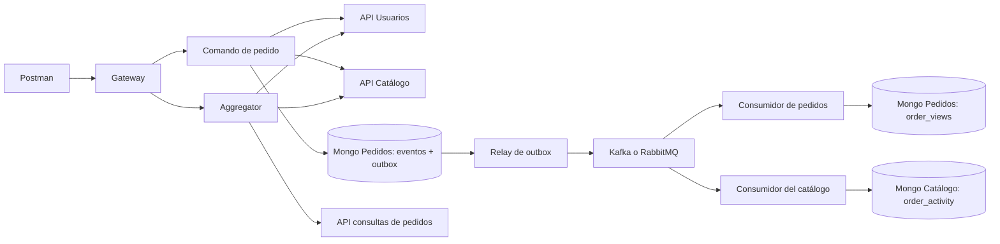

# Entrega 1: patrones implementados y guion de exposición

Ampliación del 13 de noviembre de 2026. Se conservan usuarios, catálogo y Gateway, y se añade un **pedido de demostración** que puede crearse y cancelarse. No se implementan pagos ni reservas de inventario. “EA Algorithm” se omite por indicación del usuario.

## Matriz de requisitos

| Requisito | Implementación | Evidencia observable |
| --- | --- | --- |
| API Gateway | `GatewayController`, `ForwardRequest`, `HttpServiceClient` | Entrada única `/api/...`; rutas y errores de comunicación |
| Aggregator | `AggregateOrder.execute()` en Gateway | `GET /api/orders/:id/summary` combina pedido, perfil y producto con tres llamadas HTTP |
| CQRS | `CreateOrder`/`CancelOrder` escriben eventos; `GetOrder` consulta `OrderViews` | Colecciones `order_events` y `order_views` distintas; consulta inicialmente 404 si falta proyección |
| Chained | `CreateOrder` llama `HttpOrderFacts.userExists()` y luego `product()` | Cadena Gateway → Pedidos → Usuarios/Catálogo; referencia inexistente impide guardar |
| Asynchronous | Relay publica en broker; pedidos y catálogo consumen independientemente | Proyección del pedido y actividad del catálogo se actualizan después del comando |
| Database / shared data | Database per Service; copia local de actividad por eventos | Tres Mongo distintos; catálogo nunca consulta Mongo de pedidos |
| Event sourcing | `OrderCreated`, `OrderCancelled`, `replay()` y `evolve()` | Historial, estado reconstruido y recuperación de proyección desde eventos |
| Outbox & Kafka | Outbox embebido en el documento del evento + `RelayOutbox` + KafkaJS | Pedido se guarda con broker caído; publicación posterior confirmada; reintentos |
| Kafka vs RabbitMQ | Dos adaptaciones de transporte seleccionables mediante entorno | Misma aplicación y prueba de integración con Kafka o RabbitMQ; comparación de garantías más abajo |

“Database / shared data” se interpreta como decisión de propiedad de datos: se elige una base por servicio, de acuerdo con el requisito original del proyecto. Compartir información mediante eventos no significa compartir físicamente una base. Si el profesor exige además una variante de base compartida, eso debe confirmarse; no se presenta una base compartida como implementada.

## Flujo completo



Un pedido pasa por estas etapas:

1. El cliente registra un usuario y crea un producto.
2. `POST /api/orders` envía `userId`, `productId` y `quantity`.
3. Gateway llama a pedidos. Pedidos consulta primero usuarios y luego catálogo por HTTP, sin leer bases ajenas.
4. Se toma nombre y precio del producto como información histórica del pedido y se comprueba el stock consultado. Esta consulta **no reserva ni descuenta stock**, por lo que no se promete evitar sobreventa.
5. `CreateOrder` produce un evento `OrderCreated`. Un `insertOne` guarda el evento y su marca de outbox `publishedAt: null` dentro del mismo documento.
6. El comando responde 202 después de persistir. No espera a los consumidores.
7. `RelayOutbox` publica eventos pendientes. Solo marca `publishedAt` después del ACK del broker.
8. Un consumidor de pedidos aplica el evento a `order_views`; otro consumidor, en catálogo, actualiza `order_activity` en su propia base.
9. `GET /api/orders/:id` consulta exclusivamente el modelo de lectura. Puede devolver 404 mientras llega la proyección; esto es consistencia eventual.
10. El Aggregator primero consulta el pedido para obtener sus referencias y después consulta usuario y producto en paralelo. El precio en `order` es histórico y el producto agregado contiene datos actuales; no se reemplaza el precio histórico con el actual.

## Qué código mostrar y cómo explicarlo

Todas las rutas siguientes son relativas a la raíz del repositorio.

### Pedidos: núcleo independiente

- `services/orders-service/src/order/domain/order.ts`: estado, tipos de eventos, errores y funciones `evolve()`/`replay()`. No importa Nest, Kafka ni Mongo. `replay` parte de ningún estado y aplica eventos en orden; rechaza huecos de versión y transiciones inválidas. Cancelar genera otro evento y no borra el evento de creación.
- `domain/ports.ts` dentro del mismo contexto: `OrderEventStore`, `OrderViews`, `OrderFacts`, `Outbox` y `EventPublisher`. Cada puerto expresa lo que necesita la aplicación sin definir la tecnología.
- `application/orders.ts`: comandos `CreateOrder` y `CancelOrder`, consultas `GetOrder`/`GetOrderEvents`, reconstrucción `RebuildOrder` y publicación pendiente `RelayOutbox`. Crear un pedido no escribe directamente la proyección.

Di: “Separé el modelo de escritura del de lectura. El primero conserva hechos; el segundo facilita consultas. CQRS no exige instalar una biblioteca llamada CQRS ni tener dos servidores de base de datos para el mismo servicio”.

### Persistencia y atomicidad

- `infrastructure/mongo-order-store.ts`: `MongoOrderStore.append()` inserta evento y marca pendiente de manera atómica; `load()` ordena por versión; `pending()` devuelve pendientes; `delivered()` modifica únicamente metadatos de entrega. La aplicación no reescribe el contenido del evento.
- El índice único `(aggregateId, version)` impide dos eventos con la misma versión de un pedido. Dos cancelaciones concurrentes producen un 202 y un 409.
- `MongoOrderViews.project()` ignora versiones ya aplicadas y comprueba continuidad para eventos nuevos; la actualización usa la versión esperada para evitar sobrescribir una actualización concurrente.
- `rebuild()` recupera una vista desde el historial. La vista puede eliminarse sin perder la fuente de verdad.

Di: “El outbox no requiere aquí una segunda colección: la fuente de verdad ya es un evento y su intención de publicación vive en el mismo documento. Mongo garantiza atomicidad de una escritura en un documento. No afirmo que sean atómicos Mongo y Kafka juntos”.

### Salidas HTTP y mensajería

- `infrastructure/http-order-facts.ts`: consultas de referencia por HTTP con tiempo límite; nunca conoce las conexiones Mongo de usuarios o catálogo.
- `infrastructure/order-workers.ts`: ciclo de reintento y cierre; `BrokerEventPublisher` adapta el puerto de publicación.
- `src/messaging/broker-transport.ts` en cada servicio consumidor: KafkaJS o amqplib según `EVENT_TRANSPORT`. Es infraestructura, ubicada fuera de dominio/aplicación. No se importa código de un servicio desde otro.
- `src/messaging/order-event.contract.ts`: contrato de integración versionado y validación del JSON recibido. Los servicios tienen su propia copia explícita del contrato, no comparten entidades de dominio.

### Consumidor del catálogo

- `services/catalog-service/src/activity/domain/activity.ts`: puerto de actividad.
- `activity/application/activity.ts`: recepción por puerto y consulta de cantidades activas/canceladas.
- `activity/infrastructure/activity.module.ts`: consumidor, adaptador Mongo y controlador de actividad.

Cada pedido tiene un registro de actividad identificado por `orderId`. La actualización solo acepta una versión superior. Un evento repetido no suma la cantidad otra vez. Los eventos incluyen un snapshot del pedido para que catálogo pueda aplicar una cancelación aunque no haya visto la creación. La proyección de pedidos sí exige el historial ordenado para validar transiciones.

### Agregación

`services/api-gateway/src/application/aggregate-order.ts` contiene `AggregateOrder.execute()`. Muestra que pide tres recursos y construye `{ order, user, product }`. Solo reenviar una respuesta no sería Aggregator. Si una referencia no responde correctamente, se devuelve error y no un resumen silenciosamente incompleto.

## Kafka frente a RabbitMQ en esta implementación

| Aspecto | Kafka | RabbitMQ con colas AMQP de este ejemplo |
| --- | --- | --- |
| Distribución | Topic con tres particiones | Exchange fanout y dos colas durables |
| Consumidores independientes | Dos grupos: pedidos y catálogo | Una cola para pedidos y otra para catálogo |
| Confirmación de publicación | `acks: -1` | Publisher confirms |
| Confirmación de consumo | El handler termina después de persistir; Kafka gestiona offsets | ACK manual después de persistir; NACK y reentrega ante error |
| Orden | Clave `aggregateId` mantiene un pedido en una partición | Relay secuencial y un mensaje en vuelo por consumidor (`prefetch(1)`) |
| Relectura | Eventos retenidos y offsets permiten relectura según retención | Un mensaje confirmado sale de la cola; el historial de negocio sigue en Mongo |
| Duplicados | Posibles; proyecciones idempotentes | Posibles; mismas proyecciones idempotentes |

No se afirma que RabbitMQ sea incapaz de replay: RabbitMQ Streams ofrece otra modalidad basada en un log. Esta comparación corresponde al adaptador AMQP con colas usado aquí. Tampoco se presenta un benchmark de rendimiento: ejecutar pruebas funcionales no mide cuál es “más rápido”.

El outbox sigue siendo necesario con ambos brokers: una confirmación del broker no convierte la escritura Mongo y la publicación en una sola transacción. Si el proceso cae después de publicar pero antes de marcar, el evento se reenviará. Por eso la garantía del conjunto es **al menos una vez**, no exactly-once de extremo a extremo.

## Demostración en orden

1. Registrar usuario y crear producto con Postman.
2. Crear pedido: mostrar 202 y guardar su ID.
3. Consultar pedido: explicar posible demora de la proyección.
4. Consultar resumen agregado y señalar las tres partes.
5. Consultar historial: mostrar `OrderCreated`, versión 1.
6. Consultar actividad del producto: mostrar cantidad activa.
7. Cancelar pedido: mostrar 202.
8. Volver a consultar hasta ver `cancelled`, versión 2; historial conserva ambos eventos.
9. Ejecutar `POST /api/orders/:id/rebuild`: reconstruye la consulta desde eventos. La integración automatizada borra primero la vista para demostrar recuperación real.
10. Ejecutar la integración de patrones y explicar sus comprobaciones de caída, reentrega y concurrencia.

## Ejecución reproducible

Desde la raíz:

```powershell
node scripts/verify.mjs --install
docker compose config
docker compose up --build -d --wait
$env:KAFKA_BROKERS = '127.0.0.1:19092'
node scripts/integration-patterns.mjs
```

La integración usa puertos dinámicos, sus propios tres Mongo temporales y un topic de prueba único. Necesita un broker real accesible desde el host. Sus aplicaciones no dependen de los contenedores de aplicación; solo utiliza el broker externo. Los datos de prueba son ficticios y se eliminan al finalizar las instancias Mongo.

Para RabbitMQ, generar primero credenciales locales (no se imprimen ni se guardan en Git):

```powershell
node scripts/create-rabbit-env.mjs
docker compose -f compose.yaml -f compose.rabbitmq.yaml config
docker compose -f compose.yaml -f compose.rabbitmq.yaml up --build -d --wait
```

El override desactiva el servicio Kafka por perfil y cambia el transporte de pedidos/catálogo. Para integrar desde el host, configura `EVENT_TRANSPORT=rabbitmq`, `AMQP_HOST`, `AMQP_PORT`, `AMQP_USER` y `AMQP_PASSWORD` en tu terminal. Los valores deben coincidir con el usuario creado en RabbitMQ. No pegues claves en el código. Si `.env` ya existe, el generador se detiene para no sobrescribirlo.

No cambies de Kafka a RabbitMQ con pendientes antiguos sin planificar la transición: el relay publicaría los pendientes en el transporte configurado. Para la comparación académica utiliza datos de demostración separados y muestra qué transporte está activo.

## Preguntas del profesor

**¿Dónde está event sourcing y no solo un log de auditoría?** Los comandos recuperan el estado mediante `replay(store.load(id))`; las vistas se reconstruyen a partir de los eventos. No existe un documento mutable de pedido como fuente principal.

**¿Dónde está CQRS?** Comandos escriben `order_events`; consultas leen `order_views`, actualizada por eventos. Separar únicamente GET/POST o carpetas no sería evidencia suficiente.

**¿El outbox envía mientras el broker está caído?** No puede entregar en ese momento. Conserva la intención de entrega de forma durable y reintenta cuando vuelve a estar disponible.

**¿Qué pasa después del ACK pero antes de marcar entregado?** Se puede reenviar el mismo evento. Las proyecciones reconocen versiones ya procesadas y no vuelven a aplicar sus efectos.

**¿Por qué 202?** El comando quedó persistido, pero las vistas y los consumidores independientes pueden tardar en reflejarlo.

**¿Los datos son siempre inmediatamente consistentes?** No. El historial se guarda antes de responder, mientras que las proyecciones son eventualmente consistentes. Si el broker no se recupera, no hay promesa de un tiempo máximo de actualización.

**¿Por qué existe una cadena síncrona y también eventos?** Antes de crear el pedido comprobamos referencias necesarias. Después publicamos hechos para actualizar vistas sin esperar a todos los consumidores.

**¿Qué comparte catálogo con pedidos?** Un contrato de mensajes y datos replicados de actividad. No comparte su conexión ni sus colecciones.

**¿Ya descuenta stock o cobra?** No. El pedido es demostrativo y consulta disponibilidad; no implementa reservas, pagos ni una saga de compensación.

**¿Qué falta para producción?** Autenticación y autorización, protección de operaciones administrativas como rebuild, política para eventos inválidos/DLQ, gestión de retención y evolución de contratos, límites operativos y alta disponibilidad. El Compose usa un broker de un nodo, sin tolerancia a caída de ese nodo.

## Referencias primarias

- [MongoDB: atomicidad y transacciones](https://www.mongodb.com/docs/manual/core/transactions/).
- [Patrón Transactional Outbox, Chris Richardson](https://microservices.io/patterns/data/transactional-outbox.html).
- [KafkaJS: producción](https://kafka.js.org/docs/producing) y [consumo](https://kafka.js.org/docs/consuming).
- [amqplib: confirmaciones y consumo](https://amqp-node.github.io/amqplib/channel_api.html).
- [RabbitMQ Streams y relectura](https://www.rabbitmq.com/docs/streams).

La evidencia exacta de lo ejecutado, incluido lo pendiente en Docker, está en `VERIFICACION-PATRONES.md`. Las guías anteriores describen la base previa y no deben usarse como inventario actualizado de funcionalidades.
