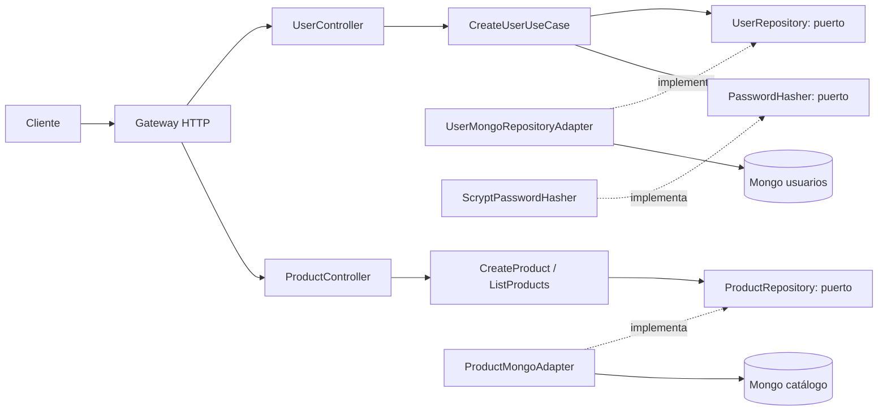

# Guía del primer avance: leer, explicar y defender el código

## Orden recomendado de lectura

Lee primero `DIAGNOSTICO.md`, luego la entidad `User`, los puertos, `CreateUserUseCase`, el controlador, el adaptador Mongo y `UserModule`. Sigue con el catálogo, el Gateway y `compose.yaml`. Finalmente ejecuta las pruebas y la demostración. Las rutas de esta guía son relativas a la raíz del repositorio.

## Qué significa arquitectura hexagonal aquí

El hexágono representa el código que resuelve el problema del negocio. No significa que deban existir seis carpetas. Nuestro núcleo tiene dominio y aplicación; HTTP, MongoDB y NestJS quedan afuera. Las dependencias del código apuntan hacia el núcleo, aunque la ejecución termine llamando a MongoDB.



Un **puerto** es un contrato requerido por el núcleo. `UserRepository` pide `SaveUser(user): Promise<User>`; no pide un `Model` de Mongoose ni una conexión. Un **adaptador** cumple el contrato usando una tecnología. `UserMongoRepositoryAdapter` traduce la entidad a un documento y viceversa. El controlador HTTP es un adaptador de entrada: convierte una petición en una llamada al caso de uso. Los repositorios y el hasher son adaptadores de salida.

La aplicación no importa NestJS ni Mongoose. `scripts/check-architecture.mjs` comprueba los imports directos de las capas internas y evita imports de código entre servicios. Es una comprobación estática sencilla, no una prueba formal de toda posible dependencia dinámica.

## Usuarios: carpetas, archivos y métodos

Dentro de `services/user-services`:

| Archivo | Responsabilidad y métodos |
| --- | --- |
| `src/main.ts` | `bootstrap()` crea Nest, activa Observe únicamente con ambas llaves, habilita cierre ordenado y escucha en el puerto configurado |
| `src/app.module.ts` | Raíz de composición: configura conexión Mongo desde `MONGODB_URI`, telemetría opcional y `UserModule` |
| `src/app.controller.ts`, `src/app.service.ts` | Conservan `getHello()` y la ruta original `GET /`; son código inicial de Nest, no la lógica de registro |
| `src/health.controller.ts` | `health()` hace ping real a la base. Devuelve 200 si responde; 503 si no está disponible |
| `src/user/domain/entities/user.entity.ts` | `User` contiene nombre, correo, hash e identificadores. Su constructor asigna propiedades; no conoce HTTP ni Mongo |
| `src/user/domain/port/repositories/user.repository.ts` | `UserRepository` declara `SaveUser`; se conserva el nombre original para evitar cambios innecesarios |
| `src/user/domain/port/password-hasher.ts` | `PasswordHasher.hash()` declara cómo pedir un hash, sin imponer algoritmo |
| `src/user/domain/errors.ts` | `InvalidUser` y `EmailAlreadyExists`: errores propios del negocio sin códigos HTTP |
| `src/user/application/use-cases/create-user.use-case.ts` | `CreateUserInput` describe la entrada. `execute()` valida tipos, normaliza nombre/correo, aplica dominio permitido y longitud de contraseña, pide el hash y guarda mediante el puerto |
| `src/user/infrastructure/adapter/scrypt-password-hasher.ts` | `hash()` usa `randomBytes(16)` y `scrypt` asíncrono de Node. Produce `scrypt$sal$clave`; no almacena texto original |
| `src/user/infrastructure/adapter/user-mongo-repository.adapter.ts` | `onModuleInit()` espera índices; `SaveUser()` usa `model.create()`, traduce el documento a entidad y convierte error Mongo 11000 en `EmailAlreadyExists` |
| `src/user/infrastructure/schemas/user.schema.ts` | `UserDocument`, `UserSchema` y `UserHydratedDocument` describen almacenamiento. `timestamps` genera fechas; correo tiene índice único; `passwordHash` tiene `select:false` |
| `src/user/infrastructure/http/user.controller.ts` | `create()` recibe `POST /users`, ejecuta el caso de uso y construye una respuesta explícita sin contraseña/hash |
| `src/user/infrastructure/http/user-error.filter.ts` | `catch()` traduce `InvalidUser` a 400 y `EmailAlreadyExists` a 409; errores inesperados siguen el manejo 500 de Nest |
| `src/user/user.module.ts` | Une controladores, esquema, filtro y dependencias mediante proveedores |
| `src/app.controller.spec.ts` | Conserva la comprobación original de “Hello World!” |
| `src/user/application/use-cases/create-user.use-case.spec.ts` | Prueba normalización, validación, delegación, propagación de errores y hashes con sal; los dobles sustituyen los puertos |
| `test/app.e2e-spec.ts` | Pruebas HTTP reales dentro de Nest con repositorio sustituido: 201, 400 y 409. No comprueban Mongo; esa tarea corresponde a `scripts/integration.mjs` |

Las propiedades `readonly` expresan que no deben reasignarse desde TypeScript. No son cifrado ni sustituyen validación. `Promise<User>` indica un resultado asíncrono: `await` permite esperar el hash y la escritura sin bloquear el hilo con una espera síncrona.

La validación está en el caso de uso para que también se aplique si mañana se invoca desde una cola. No se confía solo en el tipo TypeScript: el JSON que entra por HTTP puede tener tipos inválidos. `email.trim().toLowerCase()` evita diferencias por espacios/mayúsculas. La comparación del dominio es exacta, así `evilcorreounivalle.edu.co` no pasa. `ALLOWED_EMAIL_DOMAIN` es una política configurable del prototipo, pendiente de confirmar según los correos que acepte el proyecto. Comprobar el sufijo no demuestra que una persona controle el correo: falta verificación por email y autenticación.

El hash no se devuelve porque `create()` selecciona expresamente los campos de respuesta. `select:false` añade protección para futuras consultas de Mongoose, pero no sustituye esa selección: los documentos recién creados sí pueden contener el hash en memoria.

## Inyección de dependencias, paso a paso

En `UserModule` hay tres decisiones relevantes:

```ts
{ provide: UserRepository, useClass: UserMongoRepositoryAdapter }
{ provide: PasswordHasher, useClass: ScryptPasswordHasher }
{
  provide: CreateUserUseCase,
  useFactory: (repository, hasher) =>
    new CreateUserUseCase(repository, hasher, allowedDomain),
  inject: [UserRepository, PasswordHasher],
}
```

Este fragmento resume el proveedor real; en el archivo verás los tipos y la lectura de `process.env`. `provide` es la clave o token que se solicita al contenedor de Nest. Una clase abstracta existe en JavaScript y sirve de token; una interfaz de TypeScript desaparece al compilar. `useClass` dice qué implementación construir. `inject` enumera las dependencias que Nest entregará a la fábrica, en ese mismo orden. `useFactory` permite construir la clase de aplicación sin decorarla con `@Injectable()`.

Al arrancar, Nest registra el modelo, construye el repositorio con `@InjectModel(UserDocument.name)`, construye el hasher y llama a la fábrica del caso de uso. Finalmente inyecta ese caso de uso en `UserController` por `@Inject(CreateUserUseCase)`. El controlador no crea conexiones ni usa `new UserMongoRepositoryAdapter()`.

En las pruebas puedes hacer `new CreateUserUseCase(repoFalso, hasherFalso, dominio)` sin arrancar Nest ni Mongo. Eso demuestra la separación, además de hacer las pruebas rápidas. Para cambiar Mongo por otra base habría que implementar otro adaptador y cambiar el proveedor; la firma del puerto y el caso de uso pueden permanecer.

## Catálogo mínimo

Dentro de `services/catalog-service`, `main.ts`, `app.module.ts` y `health.controller.ts` cumplen los mismos papeles de arranque, composición y disponibilidad, pero con su propia URI y conexión.

| Archivo bajo `src/product` | Qué hace |
| --- | --- |
| `domain/product.ts` | Define contrato de datos `Product`, error `InvalidProduct` y puerto `ProductRepository` con `save()` y `list()` |
| `application/catalog.ts` | `CreateProduct.execute()` valida nombre, precio finito positivo y stock entero no negativo; guarda una lista explícita de campos. `ListProducts.execute()` pide el listado al puerto |
| `application/catalog.spec.ts` | Verifica creación/listado y cinco entradas inválidas sin Mongo |
| `infrastructure/product-mongo.adapter.ts` | Define `ProductDocument` y `ProductSchema`; `ProductMongoAdapter.save()` guarda y mapea; `list()` consulta, ordena por `_id`, limita a 100 y convierte filas a productos |
| `infrastructure/product.controller.ts` | `ProductController.create()` y `list()` exponen POST/GET; `ProductErrorFilter.catch()` devuelve 400 para reglas incumplidas |
| `product.module.ts` | Conecta esquema, repositorio y casos de uso por fábricas |

Este servicio no importa usuarios, ni lee su colección. El precio es numérico para la demostración; un modelo monetario con moneda, precisión y reglas de redondeo queda pendiente. Stock no implica reservas ni integración con pedidos. No hay categorías, búsqueda ni recomendaciones en este avance.

## Gateway y comunicación entre servicios

Dentro de `services/api-gateway`:

| Archivo | Qué hace |
| --- | --- |
| `src/domain/service-client.ts` | Define nombres de destinos, resultado `ServiceResponse`, puerto `ServiceClient.request()` y errores de disponibilidad/timeout |
| `src/application/forward-request.ts` | `ForwardRequest.execute()` delega la solicitud en el puerto, sin conocer `fetch` ni Nest |
| `src/infrastructure/http-service-client.ts` | `HttpServiceClient.request()` hace HTTP con `fetch`, URL de configuración y límite de 3 segundos; lee JSON y conserva estado; convierte fallos de red/timeout a errores propios |
| `src/infrastructure/gateway.controller.ts` | Expone rutas permitidas; `send()` traduce 502/504 y conserva respuestas del servicio; `health()` indica que el proceso Gateway responde |
| `src/infrastructure/http-service-client.spec.ts` | Usa un servidor HTTP de prueba: comprueba 409 conservado, timeout y fallo de conexión |
| `src/app.module.ts` | Construye cliente con URLs configuradas e inyecta el caso de uso |
| `src/main.ts` | Arranca el proceso independiente |

| Ruta pública | Destino HTTP interno |
| --- | --- |
| `POST /api/users` | `users:3000/users` |
| `POST /api/products` | `catalog:3000/products` |
| `GET /api/products` | `catalog:3000/products` |
| `GET /health` | Salud del propio Gateway; no promete salud de todos los destinos |

Son procesos Nest que se comunican mediante API REST, una forma válida de microservicios. No requieren usar un transporte de mensajes de `@nestjs/microservices` para cumplir esta comunicación. En Compose los nombres `users` y `catalog` se resuelven por DNS de Docker. Fuera de Docker se usan las URLs locales de `.env`.

El Gateway no tiene base, entidades de usuario ni lógica de inventario. Tiene rutas explícitas: el cliente no elige una URL arbitraria de destino. No hay reintentos automáticos de POST para evitar duplicar operaciones. Si un servicio devuelve 400/409, conserva ese estado. Si no conecta, responde 502; si vence el límite, 504. La salud del Gateway es de su proceso; las de usuarios/catálogo comprueban también Mongo.

## Recorrido de una petición hasta MongoDB

1. Se envía `POST http://localhost:3000/api/users` con JSON de registro.
2. `GatewayController.createUser()` llama a `send()`; este invoca `ForwardRequest.execute()`.
3. El puerto `ServiceClient` está asociado a `HttpServiceClient`. Este serializa el JSON y hace `POST http://users:3000/users`.
4. Nest convierte el cuerpo JSON en un objeto y llama a `UserController.create()`.
5. El controlador llama a `CreateUserUseCase.execute()` con ese objeto.
6. El caso de uso valida y normaliza los datos; solicita `PasswordHasher.hash()`; recibe un hash scrypt con sal aleatoria.
7. Construye `User` con el hash y llama a `UserRepository.SaveUser()`.
8. La instancia inyectada es `UserMongoRepositoryAdapter`. `model.create()` valida según el esquema y envía la escritura a MongoDB, que aplica el índice único de correo.
9. Mongo genera `_id` y fechas. El adaptador construye una entidad con esos datos. Si dos registros usan simultáneamente el mismo correo, solo uno puede superar el índice único; el otro genera 11000, traducido a error de negocio.
10. El controlador elige `id`, `name`, `email`, `createdAt`; Nest responde 201. El Gateway devuelve ese estado y ese JSON al cliente. La contraseña original nunca se persiste en este flujo.

La ida de ejecución llega al adaptador; la dependencia de código sigue invertida: el caso de uso solo conoce el puerto. Ante un correo inválido se interrumpe antes del hash y de Mongo. Ante duplicado el filtro devuelve 409. Un fallo inesperado queda como 500 del servicio; los fallos de comunicación entre procesos los maneja el Gateway.

## SOLID aplicado con ejemplos

| Principio | Ejemplo verificable |
| --- | --- |
| S: responsabilidad única | Caso de uso valida/orquesta registro; hasher protege contraseña; repositorio persiste; controlador adapta HTTP; filtro traduce errores |
| O: abierto a extensión | Se puede añadir un repositorio alternativo que implemente el puerto y conectarlo en el módulo, sin editar el caso de uso |
| L: sustitución | En las pruebas un repositorio falso cumple `SaveUser` y devuelve `Promise<User>` igual que el adaptador real; no debe cambiar las expectativas del caso de uso |
| I: segregación | `PasswordHasher` solo pide `hash`; no mezcla correo, pagos o repositorio. Los puertos contienen las operaciones del alcance actual |
| D: inversión | `CreateUserUseCase` depende de `UserRepository`/`PasswordHasher`, no de Mongoose/scrypt. La infraestructura implementa los contratos y el módulo elige las instancias |

SOLID es una guía de responsabilidades y dependencias, no una certificación por cantidad de archivos. Mantener operaciones pequeñas evita introducir abstracciones para funcionalidades que todavía no existen.

## Configuración y archivos de soporte

Cada servicio tiene su propio `package.json` y `package-lock.json`, dependencias, compilación y `Dockerfile`; ninguno usa el `node_modules` de otro para ejecutarse. `tsconfig.json` configura TypeScript ESM y decoradores; `tsconfig.build.json` limita la compilación de producción a `src` sin tests. `nest-cli.json` configura el compilador de Nest. `vitest.config.ts` selecciona unitarias; el archivo e2e selecciona pruebas HTTP (solo usuarios tiene e2e separada; la integración global cubre los tres procesos). `.oxlintrc.json` configura lint. `.env.example` contiene valores de desarrollo y llaves vacías, nunca secretos reales. `.dockerignore` evita copiar dependencias locales y `.env` a la imagen.

El Dockerfile tiene dos etapas: la primera instala con `npm ci`, compila y elimina dependencias de desarrollo; la segunda copia solo runtime, ejecuta como usuario `node` y arranca `dist/main.js`. No necesita acceso a código ni paquetes de otro servicio. Usa Node 24; la ejecución local verificada usó Node 26.5.0, por lo que falta confirmar la imagen en Docker.

`compose.yaml` crea cinco contenedores: dos Mongo, dos servicios y Gateway. `users-data` y `catalog-data` son volúmenes distintos. Cada Mongo está en una red interna propia; los servicios usan esas redes y la red HTTP `backend`. Solo el Gateway publica puerto, limitado a `127.0.0.1:3000`. No hay credenciales predeterminadas: esta composición es exclusivamente de desarrollo local, con bases sin puertos publicados. Un despliegue real necesita autenticación y gestión externa de secretos.

`depends_on` con `service_healthy` espera las comprobaciones antes del arranque; no es un mecanismo que reinicie todo ante cada caída. El arranque conjunto del Gateway espera inicialmente ambos servicios; una caída posterior se gestiona por petición y no debe bloquear el otro destino.

## Qué verifican los scripts

`scripts/verify.mjs` prepara temporales locales, ejecuta el control de arquitectura, compila, comprueba tipos incluyendo tests, ejecuta unitarias, lint y las pruebas HTTP de usuarios. Con `--install` primero ejecuta `npm ci` en cada servicio.

`scripts/integration.mjs` usa la dependencia de desarrollo `mongodb-memory-server` de usuarios. Esta inicia **dos procesos mongod reales**, no repositorios simulados. Descarga un binario en la primera ejecución (en Windows puede superar 750 MB), usa carpetas y puertos temporales y lanza los tres `dist/main.js` como procesos independientes. Comprueba 201/400/409, duplicado concurrente, índice único, hash persistido, ausencia de contraseña en respuesta/documento, producto guardado/listado, separación de colecciones, 502 por servicio caído y funcionamiento del otro servicio. Reinicia catálogo y comprueba que el producto sigue guardado en la misma instancia Mongo. Cierra procesos y bases al finalizar; esos datos son temporales.

Esta integración **no verifica las imágenes Docker ni la persistencia de volúmenes tras recrear contenedores**. Para eso se debe ejecutar el guion de `DEMOSTRACION.md` en un equipo con Docker.

## Límites para la defensa

Se implementó registro, no login/JWT, permisos, sesiones ni recuperación de contraseña. El sufijo del correo no acredita pertenencia a la Universidad. El catálogo es un ejemplo reducido y no tiene autorización de escritura. No hay frontend React, pedidos, pagos, búsqueda ni recomendaciones. Esto permite demostrar las bases arquitectónicas del avance sin presentar el e-commerce como terminado. La siguiente etapa debe incluir verificación de correo, autenticación y autorización antes de ampliar capacidades de negocio.

Referencias: proveedores `useClass`/`useFactory` en [documentación oficial de NestJS](https://docs.nestjs.com/fundamentals/custom-providers); orden de arranque y `service_healthy` en [documentación oficial de Docker Compose](https://docs.docker.com/compose/how-tos/startup-order/).
